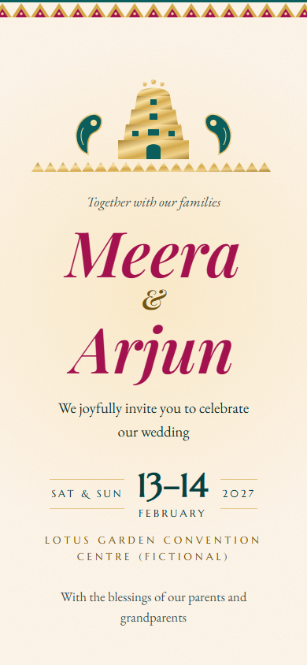

# South Indian Wedding Invitation Designer

An open-source [Agent Skill](https://agentskills.io) that helps an AI assistant design **animated, mobile-first South Indian wedding e-invites** to share as a link on WhatsApp, for Kannada, Tamil, Telugu and Malayalam families.

It interviews you for the exact event facts, offers three design directions, fills one self-contained HTML template (events, calendar grid, countdown, map, add-to-calendar, optional couple photo and music), checks contrast, phone layout and link previews, and drafts the share message. It never invents names, dates, timings or regional-language wording.

| Mysuru Aramane (default) | Mallige Botanical | Kanjeevaram Border |
|---|---|---|
|  |  |  |

The sample uses a fictional couple (Meera & Arjun) and a fictional venue. Open `examples/sample-invite.html` in a browser (add `?preset=temple-kolam`, or any other preset id, to preview another look). `examples/screenshots/` has the cover, hero, save-the-date, events and venue views for these three presets, taken at 390 by 844 px.

## What it does

1. **Collects and locks the facts.** One question at a time, each with a recommended answer. Uses only what you supply; a printed card or another website you share is treated as reference only.
2. **Offers three directions** from six built-in presets: `mysuru-aramane` (royal ivory, maroon and antique gold; the default), `mysore-silk-minimal`, `mallige-botanical`, `temple-kolam`, `kanjeevaram-border`, `contemporary-ivory`. Religious motifs stay off unless you ask.
3. **Fills the template** (`skills/south-indian-wedding-invitation-designer/assets/invite-template.html`) by editing one JSON config block and the link-preview tags.
4. **Adds an optional photo and music** with consent, clean cut-outs, quiet levelled music, required credits and no autoplay.
5. **Runs QA** before showing anything: screenshots at phone width, a placeholder scan (`?check`), contrast, opens-at-top, calendar timezone, reduced motion, performance, privacy.
6. **Helps you share:** WhatsApp preview tags, a share message draft, and hosting options you deploy yourself.

## Install

### Claude.ai (web and desktop apps)

1. Get the zip:
   - From the v1.0.0 release onwards, download `south-indian-wedding-invitation-designer.zip` from this repository's Releases page.
   - Or build it yourself from a clone (see below).
2. Make sure code execution is turned on (Settings > Capabilities).
3. Go to **Customize > Skills > + > Create skill > Upload a skill** and choose the zip.

**Build the zip yourself.** The zip must contain the folder `south-indian-wedding-invitation-designer/` at its root (with `SKILL.md`, `LICENSE.txt`, `references/` and `assets/` inside). From the repository root, with Python 3:

```text
python -c "import os; os.makedirs('dist', exist_ok=True)"
python -m zipfile -c dist/south-indian-wedding-invitation-designer.zip skills/south-indian-wedding-invitation-designer
python -m zipfile -l dist/south-indian-wedding-invitation-designer.zip
```

On macOS or Linux you can instead run `cd skills && zip -r ../dist/south-indian-wedding-invitation-designer.zip south-indian-wedding-invitation-designer`. `dist/` is ignored by git.

### Claude Code

```text
/plugin marketplace add DataFinFreak/south-indian-wedding-invitation-designer
/plugin install south-indian-wedding-invitation-designer@datafinfreak-skills
```

Or copy `skills/south-indian-wedding-invitation-designer` into `~/.claude/skills/` (personal) or `.claude/skills/` (project).

### Other agents (skills CLI)

```text
npx skills add DataFinFreak/south-indian-wedding-invitation-designer
```

### ChatGPT, Codex and Gemini

The skill uses the open Agent Skills format (`SKILL.md` + `references/` + `assets/`), so it is not Claude-only. It has been tested in Claude; other tools should work but render and check the result in their own way.

- **ChatGPT / Codex:** add the `skills/south-indian-wedding-invitation-designer` folder as a skill (see OpenAI's skills docs), then invoke it with `@` in ChatGPT or `$` in Codex.
- **Gemini CLI:** copy the folder into `~/.gemini/skills/`.
- **Gemini app (Gems) or any chatbot without skill support:** paste `SKILL.md` into the Gem's instructions or the chat, and attach `assets/invite-template.html` and the `references/` files you need.

## Try it

> "Make a WhatsApp wedding invite for Meera and Arjun. Muhurtham on 14 February 2027, 9:30 to 10:30 am, reception the evening before from 7 pm, both at Lotus Garden Convention Centre, Mysuru. Something royal but not loud."

The skill will ask for anything missing (for example the full address), offer three directions, then build and check the page.

## Capabilities and limits

| Environment | What you get |
|---|---|
| Chat only, no tools | Interview, wording, direction sketches, the filled HTML file, share message, print checklist. No visual QA (the skill says so). |
| Code execution | Filled file saved, placeholder scan, phone-width screenshots, og:image resize, photo metadata stripping. |
| Python with rembg (optional) | Couple photo background removal (`birefnet-portrait`), measured rotation, face-centred crop. |
| ffmpeg (optional) | Music trimming, fade-in and levelling to about -30 dB mean. |
| Image generation | Not assumed; the skill only writes prompts, and never alters a real person's likeness. |

**Template behaviour worth knowing**

- Test parameters: `?autoopen` skips the cover instantly with motion off, `?check` lists every unfilled placeholder and config warning in a banner, and `?preset=<id>` previews another preset without editing. A JSON mistake in the config shows a "Config error" banner.
- Section labels and buttons ("Save the Date", "Join us for", "Open in Maps" and so on) are fixed English strings. To use another language, edit those strings in the template with wording you supply or approve.
- Calendar: a Google Calendar link and a `.ics` download per event, both in UTC converted from the config timezone. An event with no end time gets a 3-hour entry.
- The `noindex` robots tag ships commented out; uncomment it while you preview privately.
- Music never autoplays; when a track is set, the footer shows its credit.

**Not included in v1:** print-ready press files (a print-spec checklist only), video or Status invites, RSVP backends, per-guest personalised links, generated music, hosting or deploying for you, and machine translation into regional languages. Regional-language lines are used only when you supply or approve them, and are flagged for checking with a native speaker. The regional conventions in the references are partly synthesised and marked **VERIFY**.

## Privacy

- The skill never invents or adds personal details and never copies details from reference material without asking.
- It recommends stripping photo metadata (including GPS), neutral filenames, a `noindex` tag while previewing, and keeping phone numbers and home addresses off a link anyone can forward.
- It never deploys for you and never touches your existing websites.
- This repository contains no real wedding data, photos or music. All sample content is fictional.

## Repository layout

```text
.claude-plugin/marketplace.json   Claude Code plugin marketplace entry
skills/south-indian-wedding-invitation-designer/
  SKILL.md                        the workflow the AI follows
  LICENSE.txt                     Apache-2.0 (copy, travels with the zip)
  references/                     style presets, regional conventions, digital delivery,
                                  photo handling, quality checklist (loaded on demand)
  assets/invite-template.html     single-file template (HTML, CSS, JS inline)
examples/                         fictional sample invite and screenshots
evals/                            test prompts and expected behaviours
```

## Credits

- Author: Manoj ([DataFinFreak](https://github.com/DataFinFreak)).
- Built from the experience of designing a real family e-invite with an AI assistant; every correction from that project became a rule or pitfall in the skill. No personal data from it is included.
- Fonts: Google Fonts families under the SIL Open Font License, referenced by link, not bundled. See [THIRD_PARTY_NOTICES.md](THIRD_PARTY_NOTICES.md).
- Motifs in the template are original SVG drawn for this project.

## Licence

[Apache-2.0](LICENSE). Copyright 2026 Manoj (DataFinFreak). Third-party notices in [THIRD_PARTY_NOTICES.md](THIRD_PARTY_NOTICES.md).
